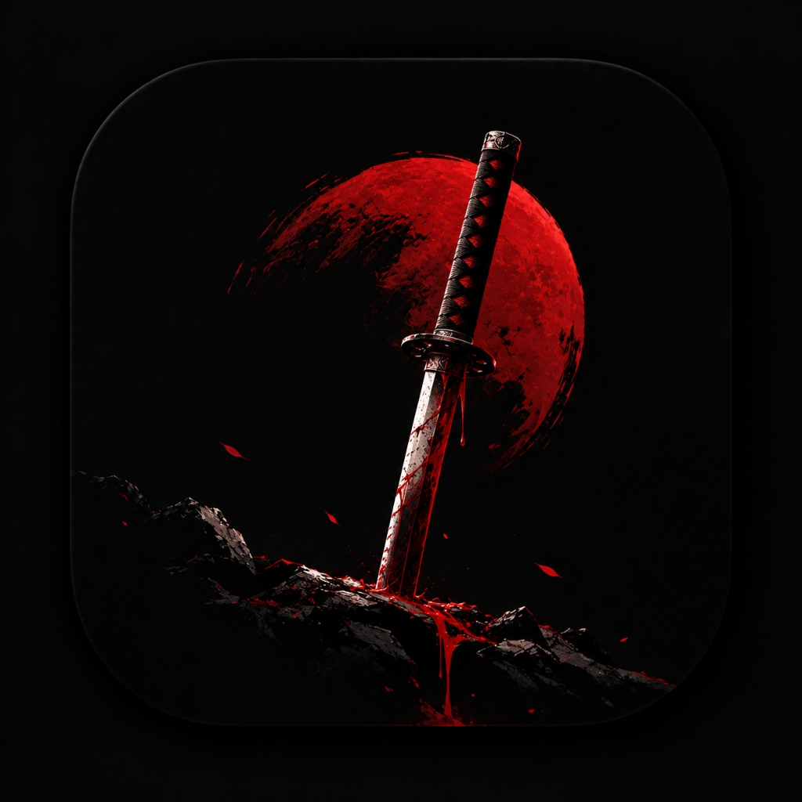
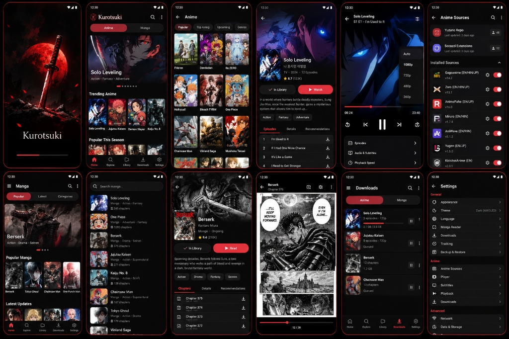

<div align="center">




### A modern, open-source anime & manga platform — combining Anikku & Futon on Android & TV


<br/>

[](https://github.com/Arikisitu/Kurotsuki/releases/latest)
[](https://github.com/Arikisitu/Kurotsuki/releases)
[](https://github.com/Arikisitu/Kurotsuki/stargazers)
[](https://github.com/Arikisitu/Kurotsuki/network/members)
[](LICENSE)
[](https://github.com/Arikisitu/Kurotsuki/issues)

<br/>


<br/>

<a href="https://github.com/Arikisitu/Kurotsuki/releases/latest">
  
</a>
&nbsp;
<a href="https://github.com/Arikisitu/Kurotsuki/releases">
  
</a>

<br/><br/>

<p align="center">
  <a href="#-overview"><b>Overview</b></a> ·
  <a href="#-12-screen-experience"><b>12 Screens</b></a> ·
  <a href="#-key-features"><b>Key Features</b></a> ·
  <a href="#️-download"><b>Download</b></a> ·
  <a href="#-platforms--roadmap"><b>Platforms</b></a> ·
  <a href="#-tech-stack"><b>Tech Stack</b></a> ·
  <a href="#-faq"><b>FAQ</b></a> ·
  <a href="#-disclaimer"><b>Disclaimer</b></a> ·
  <a href="#-license"><b>License</b></a>
</p>


</div>

## 🎬 Overview

**KUROTSUKI (黒月)** is a modern, high-performance open-source platform that brings anime streaming and comic reading into one unified, aesthetics-first mobile application.

It combines the battle-tested architectures of two open-source leaders:
- **[Anikku](https://github.com/komikku-app/anikku)** (`komikku-app/anikku`): Dedicated anime discovery, recommendation suggestions, panoramic hero spotlight, and multi-source streaming resolvers.
- **[Futon](https://github.com/AppFuton/Futon)** (`AppFuton/Futon`): Triple-engine comic reader (Webtoon continuous scroll, Paged RTL, Paged LTR), chapter discovery, and publication sorting.

Kurotsuki features top segmented switching between **Anime** and **Manga** modes, unified bottom navigation across **Home**, **Explore**, **Library**, **Downloads**, and **Settings**, and full **Android TV** D-Pad support.

> [!NOTE]
> **Track your watching and reading history in one place with offline downloads and zero intrusive advertisements.**

<div align="center">

| 🎬 Watch Anime | 📚 Read Manga | 📈 Track & Sync | ⚡ Multi-Source |
|:---:|:---:|:---:|:---:|
| Anikku streaming engine & ExoPlayer | Futon triple-engine comic reader | AniList & MyAnimeList tracking | Yūzōnō & Secozzi extensions |

</div>

---

## 📸 12-Screen Experience

Kurotsuki is built upon a pixel-perfect 12-screen design specification covering every step of the discovery, playback, reading, and management lifecycle:

<div align="center">



</div>

<br/>

<div align="center">

| # | Screen | Blueprint Role | Features |
|:---:|:---|:---|:---|
| **1** | **Splash** | Brand Entry | Katana Blood Moon emblem with circular crimson glow, animated progress bar |
| **2** | **Anime Home** | Anime Discovery | Segmented `[ Anime \| Manga ]` toggle, Solo Leveling hero, Anikku suggestions |
| **3** | **Anime Explore** | Catalog Browsing | 3-column media grid with subtabs (`Popular`, `Top Airing`, `Upcoming`, `Genres`) |
| **4** | **Anime Details** | Content Hub | Panorama cover, crimson `[ Watch Ep 1 ]`, `[ In Library ]`, 3 tabs (Episodes, Details, Relations) |
| **5** | **Anime Player** | Streaming Engine | AMOLED ExoPlayer, center controls, crimson scrubber (`08:24/23:40`), quality popup |
| **6** | **Anime Sources** | Extension Vault | Yūzōnō Repo, Secozzi Extensions, source switcher (Gogoanime, Zoro, AnimePahe, etc.) |
| **7** | **Manga Home** | Comic Discovery | Futon Onyx Gold aesthetic, Berserk hero spotlight, publication carousels |
| **8** | **Manga Explore** | Chapter Search | Instant search, format filter chips (`All`, `Manga`, `Manhwa`, `Manhua`), chapter counts |
| **9** | **Manga Details** | Chapter Index | Berserk panorama, `[ START READING CH. 1 ]`, ascending/descending chapter sorting |
| **10** | **Manga Reader** | Reading Canvas | Webtoon continuous strip, Paged RTL, Paged LTR, red seekbar, page counter (`12 / 28`) |
| **11** | **Downloads** | Offline Storage | Segmented `[ Anime \| Manga ]` manager, download progress bars, internal storage metrics |
| **12** | **Settings** | Preferences | General, Anime, Advanced, cache cleaner, theme selection, direct link to Sources |

</div>

---

## ✨ Key Features

### 📺 Anikku Anime Streaming Engine
- **Signature Anikku Aesthetic**: Canvas Dark (`#0A0D14`), Surface (`#101522`), and Crimson Katana (`#E53935`) accents.
- **Anikku Suggestions Engine**: Smart algorithm surfacing recommendations based on your favorite anime.
- **Panorama Cover Spotlight**: Full-width panoramic artwork with one-click **"Watch Ep 1"** action.
- **Latest Episode Updates Feed**: Chronological release timeline with `Ep X`, `1080p HD`, `SUB / DUB` badges, and relative timestamps (`25m ago`, `1h ago`).
- **YouTube-Style AMOLED Player**: Popup video quality selection (`Auto`, `1080p`, `720p`, `480p`, `360p`), playback speed selector (`0.5x`–`2.0x`), multi-audio tracks (`English`, `Hindi`, `Japanese`), 10s skip gestures, and hardware-accelerated Media3 ExoPlayer.

### 🏮 Futon Manga Reader & Comic Hub
- **Onyx Gold Palette**: Velvet Black base (`#0D0D0D`) with radiant **Manga Gold** (`#FEA628`) active highlights.
- **18:13 Media Cards**: 16dp rounded corner cards with subtle Warm Clay borders, star ratings, and publication badges.
- **Triple-Engine Reader**:
  1. **Webtoon Mode**: Gapless continuous vertical strip for Korean Manhwa and Webtoons.
  2. **Paged RTL Mode**: Traditional right-to-left layout for Japanese manga.
  3. **Paged LTR Mode**: Left-to-right layout for Western comics and graphic novels.
- **Reading Controls**: Crimson seekbar, page counter (`12 / 28`), chapter navigator, and double-tap zoom.

### ⚡ Extension Vault & Multi-Source Resolvers
- **Open Extension Catalogues**: Compatible with verified catalogues including **Yūzōnō Repo** and **Secozzi Extensions**.
- **Live Latency Testing**: Automated round-trip TTFB latency testing to pick the fastest responding server CDN.
- **Seamless Failover**: If a source stream buffers or fails, Kurotsuki transparently falls back to the next available provider.

---

## ⬇️ Download

Get the latest verified build from the **[GitHub Releases](https://github.com/Arikisitu/Kurotsuki/releases/latest)** page.

<div align="center">

| File | Type | Recommended for | SHA-256 Checksum |
|:---|:---:|:---|:---|
| 🟢 [`kurotsuki-v0.1.0-debug.apk`](https://github.com/Arikisitu/Kurotsuki/releases/download/v0.1.0/kurotsuki-v0.1.0-debug.apk) | Universal APK | All Android devices (Android 8.0+) — **Recommended** | `50893016185CDFF0F7068233170E111A3D84C0196526905534C7E36C546E46F2` |

</div>

### 📲 Installation via ADB

```bash
# Clone the repository and install the APK
git clone https://github.com/Arikisitu/Kurotsuki.git
cd Kurotsuki
adb install -r kurotsuki-v0.1.0-debug.apk
```

> [!TIP]
> Kurotsuki checks GitHub Releases for new updates and lets you update directly from **`Settings → Check for Updates`**.

---

## 🧩 Platforms & Roadmap

<div align="center">

| Platform | Status |
|:---|:---:|
| 🤖 Android (Mobile & Tablet) | ✅ Available (`v0.1.0`) |
| 📺 Android TV | ✅ Available (D-Pad Ready) |
| 🌐 Web PWA (React + Vite) | 🚧 Available in `apps/web` |
| 🪟 Windows Desktop | 📋 Planned |
| 🍎 iOS | 📋 Planned |

</div>

- [x] Rebrand to Kurotsuki with Katana Blood Moon emblem
- [x] Complete 12-screen Anikku + Futon specification
- [x] Unified 5-tab bottom navigation (`Home`, `Explore`, `Library`, `Downloads`, `Settings`)
- [x] AMOLED ExoPlayer with resolution selection & multi-audio
- [x] Triple-engine comic reader (Webtoon, Paged RTL, Paged LTR)
- [x] Extension vault with Yūzōnō & Secozzi catalogues
- [ ] Offline download background sync worker
- [ ] Cloud backup & restore across devices

---

## 🛠 Tech Stack

<div align="center">


</div>

<br/>

- **Android Framework**: Kotlin 2.0.0, Jetpack Compose (BOM 2024.06.00), Material 3
- **Video Playback**: AndroidX Media3 ExoPlayer 1.3.1 (HLS, DASH, MP4 hardware acceleration)
- **Local Persistence**: Room 2.6.1 + KSP, DataStore Preferences 1.1.1
- **Networking & API**: Retrofit 2.11, OkHttp 4.12, AniList GraphQL Client
- **Image Pipeline**: Coil Compose 2.7.0 with disk and memory LRU caching
- **Architecture**: MVVM with unidirectional data flow (UDF) & Kotlin StateFlow

---

## ❓ FAQ

<details>
<summary><b>Does Kurotsuki host or stream any copyrighted media?</b></summary>
<br/>
No. Kurotsuki is an open-source client, tracker, and media management tool only. It does not host, upload, or rehost any media content on its servers. It connects to user-configured open APIs, community catalogues, and official discovery endpoints.
</details>

<details>
<summary><b>Which Android version is required?</b></summary>
<br/>
Kurotsuki supports <b>Android 8.0 (API level 26)</b> and newer, including Android 14 and Android 15 developer previews.
</details>

<details>
<summary><b>How does the video quality resolution popup work?</b></summary>
<br/>
The player parses the multi-bitrate HLS master playlist from the active provider. Tapping the quality icon opens a popup where you can choose between <code>Auto (1080p)</code>, <code>1080p</code>, <code>720p</code>, <code>480p</code>, and <code>360p</code>.
</details>

<details>
<summary><b>How do I switch between Webtoon and traditional manga reading?</b></summary>
<br/>
In the manga reader, tap the settings icon in the top right to switch between <b>Webtoon</b> (vertical scroll), <b>Paged RTL</b> (right-to-left), and <b>Paged LTR</b> (left-to-right).
</details>

<details>
<summary><b>Is Kurotsuki completely free?</b></summary>
<br/>
Yes — Kurotsuki is 100% free and open-source under the GNU GPL-3.0 license.
</details>

---

## ⚠️ Disclaimer

> [!IMPORTANT]
> **Kurotsuki is a personal library management and media client.** It does not host, provide, distribute, or maintain streaming media or copyrighted files.

- **User Responsibility**: Users are solely responsible for how they use the app, the extensions they configure, and compliance with local laws and intellectual property rights.
- **No Liability**: The developers disclaim all liability for third-party services or content accessed through external extensions.
- **Attribution**: Built with respect to the open-source achievements of **Anikku** and **Futon**.

---

## 👥 Contributors & Community

<div align="center">

<a href="https://github.com/Arikisitu/Kurotsuki/graphs/contributors">
  
</a>

<br/><br/>

<a href="https://github.com/Arikisitu/Kurotsuki/issues">
  
</a>
&nbsp;
<a href="https://github.com/Arikisitu/Kurotsuki/discussions">
  
</a>

</div>

---

## 📜 License

Copyright © 2026 **Kurotsuki Contributors**

Kurotsuki is licensed under the **[GNU GPL-3.0](LICENSE)**.

<div align="center">

<br/>


### Kurotsuki (黒月)
*Made with ❤️ for anime and manga enthusiasts worldwide.*

<br/>

[⭐ Star the repository](https://github.com/Arikisitu/Kurotsuki)
&nbsp;&nbsp;•&nbsp;&nbsp;
[⬇️ Download APK](https://github.com/Arikisitu/Kurotsuki/releases/latest)
&nbsp;&nbsp;•&nbsp;&nbsp;
[🐛 Report an issue](https://github.com/Arikisitu/Kurotsuki/issues)

<br/>


</div>
