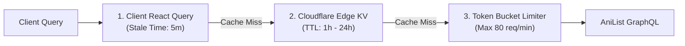

# SAHASRA Upstream Provider Integration Matrix

## ✦ Provider Capabilities Matrix

SAHASRA aggregates metadata from external sources to deliver an uninterrupted media catalog. **AniList GraphQL v2** serves as the primary source of truth, while secondary providers serve as fallbacks and identifier cross-references.

| Feature / Capability | AniList GraphQL v2 (Primary) | MyAnimeList API v2 (Secondary) | Kitsu API v1 (Fallback) |
| :--- | :---: | :---: | :---: |
| **Protocol** | GraphQL (POST) | REST (GET / POST) | JSON:API / REST |
| **Authentication for Public Browsing** | **None Required** | Client ID Header Required | None Required |
| **Rate Limit** | 90 req / min | 120 req / min | 60 req / min |
| **Anime Search & Filter** | Full (Genres, Year, Season, Tag) | Partial (Basic query) | Partial |
| **Manga Search & Filter** | Full | Partial | Basic |
| **Seasonal Releases** | Native Query Support | Limited | Limited |
| **Live Airing Schedule** | Native `AiringSchedule` GraphQL | Not Supported | Not Supported |
| **Character & Voice Actors** | Full Cast & Credits Tree | Basic Characters | Basic |
| **User Library Tracking** | GraphQL OAuth 2.0 Mutations | OAuth 2.0 PKCE | OAuth 2.0 |
| **High-Res Artwork** | ExtraLarge + Color Hash | Standard (Large) | Original / Poster |

---

## ⚡ Primary Provider: AniList GraphQL

### Endpoint
- Public Endpoint: `https://graphql.anilist.co`
- Method: `POST`
- Content-Type: `application/json`

### Rate Limiting & Quotas
- AniList permits **90 requests per minute** per client IP.
- The response includes headers:
  - `X-RateLimit-Limit`: Maximum requests allowed in the current window (90).
  - `X-RateLimit-Remaining`: Count of requests remaining.
  - `Retry-After`: Seconds until quota reset when `429 Too Many Requests` is reached.

### Public Querying Model
All public discovery queries (trending anime/manga, seasonal lists, airing schedule, media details, character guides) **do not require any API keys or tokens**.

---

## 🛡️ Resilience & Caching Strategy

To prevent downstream exhaustion of the 90 req/min limit, SAHASRA implements a three-tier caching hierarchy:

### Cache TTL Policies
| Dataset Classification | Cache TTL | Rationale |
| :--- | :--- | :--- |
| **Airing Schedule (Today)** | 15 minutes | Real-time countdown accuracy |
| **Trending / Popular Media** | 1 hour | Dynamic changes throughout the day |
| **Seasonal Catalogs** | 6 hours | Periodically updated airing times |
| **Finished Anime / Manga Details** | 24 hours | Static metadata and credits |
| **Genres & Tags Catalog** | 7 days | Rarely modified taxonomy |

### Error & Circuit Breaker Policies
1. **HTTP 429 (Rate Limited)**:
   - Immediately parse `Retry-After` header.
   - Serve stale cache entry if available with `stale-while-revalidate`.
   - Delay scheduled background jobs until quota replenishes.
2. **HTTP 5xx (Upstream Down)**:
   - Fall back to secondary metadata cache or Kitsu public endpoint for basic titles.
   - Emit categorized `ProviderError` with code `PROVIDER_DOWN`.
