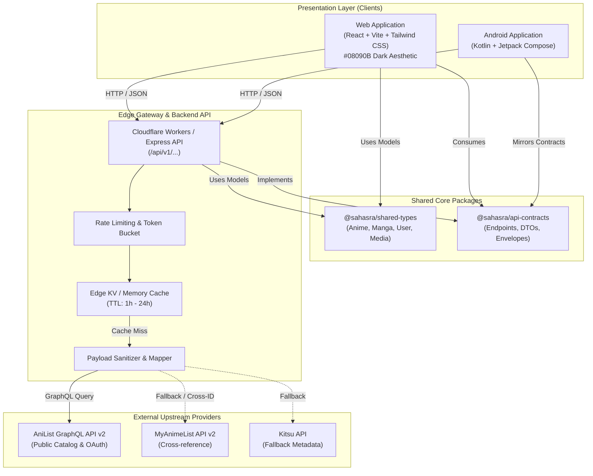

# SAHASRA Architecture & Component Overview

## ✦ Executive Summary

**SAHASRA** is built as a high-performance, multi-platform media discovery and tracking ecosystem. It leverages a modern TypeScript monorepo architecture, AniList GraphQL v2 as its primary upstream source of truth, an edge API gateway with intelligent caching, and specialized clients for Web and Native Android.

---

## 🏛️ System Architecture Diagram



---

## 📦 Monorepo Package Hierarchy

The monorepo is partitioned into strictly bounded layers:

### 1. Domain Types (`packages/shared-types`)
- **Independent & Zero Dependencies**: Contains canonical data models (`Anime`, `Manga`, `BaseMedia`, `UserProfile`, `WatchProgress`).
- **Target Agnostic**: Consumed by web frontend, edge worker backend, and automated tests.

### 2. API Contracts (`packages/api-contracts`)
- **Type-Safe API Boundary**: Defines every HTTP endpoint route, request body, query parameter interface, and standardized `ApiResponse<T>` envelope.
- **Error Model Standard**: Enforces uniform error codes (`VALIDATION_ERROR`, `RATE_LIMITED`, `UPSTREAM_ERROR`).

### 3. Applications (`apps/`)
- **`apps/web`**: Single-Page Application (SPA) built with React 18+, TypeScript, Tailwind CSS, and Lucide icons.
- **`apps/api`**: Edge Gateway built for Cloudflare Workers (and compatible with Express for local dev) providing AniList GraphQL federation, caching, and rate limit defense.
- **`apps/android`**: Native Android app written in Kotlin using Jetpack Compose, Retrofit/OkHttp, and Material3 with the SAHASRA obsidian design system.

---

## 🔄 End-to-End Data Flow

1. **User Request**: User opens the Web or Android app to browse Trending Anime.
2. **Client Dispatch**: The client executes an HTTP request to `GET /api/v1/anime/trending?page=1&perPage=20`.
3. **Gateway Inspection**:
   - The Edge Gateway validates incoming parameters against `@sahasra/api-contracts`.
   - Checks the edge cache key `cache:anime:trending:p1:limit20`.
4. **Cache Hit vs Miss**:
   - **Hit**: Returns cached payload immediately (< 25ms response time) with `meta.cached: true`.
   - **Miss**: Gateway forwards an optimized GraphQL query to AniList's public API (`https://graphql.anilist.co`).
5. **Data Transformation**: The gateway maps AniList's raw nested response into SAHASRA's canonical `@sahasra/shared-types` domain model, applies markdown sanitation to synopses, and extracts dominant artwork colors.
6. **Edge Persistence**: The transformed payload is committed to Edge KV with a cache TTL (1 hour for trending lists, 24 hours for concluded media).
7. **Client Rendering**: Client receives a typed `AnimeListResponse` and renders cards utilizing the `#08090B` dark theme.

---

## 🎨 Design System Foundation

The platform adheres to the SAHASRA Design Tokens:

```css
:root {
  --sahasra-bg: #08090B;          /* Canvas Base */
  --sahasra-surface-1: #111318;   /* Cards, Navbars */
  --sahasra-surface-2: #191C22;   /* Modals, Dropdowns */
  --sahasra-border: #292C35;      /* Structural Dividers */
  --sahasra-accent-primary: #8585F7;   /* CTAs, Focus */
  --sahasra-accent-secondary: #AAA7FF; /* Badges, Glow */
  --sahasra-text-primary: #F5F5F7;     /* High Contrast Text */
  --sahasra-text-secondary: #A0A3AE;   /* Subtitles & Meta */
  --sahasra-brand-crimson: #E64B55;    /* Live/Airing, Alerts */
}
```
